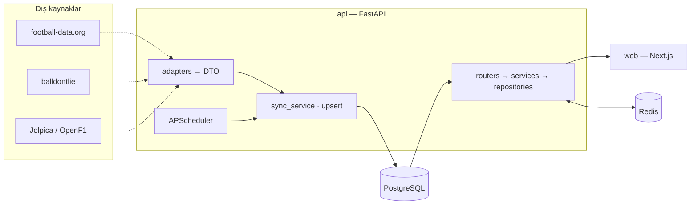

# Just Sport

Çok sporlu, modüler bir spor veri platformu. Bir Python servisi dış API'lerden veri çeker, ortak bir şemaya normalize edip PostgreSQL'e yazar; Next.js arayüzü yalnızca kendi API'mizi okur. **Yeni bir spor eklemek = yeni bir adapter sınıfı yazmak.**

> Durum: **v0.1.0 — Futbol MVP.** Basketbol ve Formula 1 adapter'ları sıradaki aşamada ([docs/PROGRESS.md](docs/PROGRESS.md)).

<!-- Ekran görüntüleri Aşama 6'da eklenecek -->
| Bugünün maçları | Lig · Puan tablosu | Takım |
| --- | --- | --- |
| _ekran görüntüsü yer tutucusu_ | _ekran görüntüsü yer tutucusu_ | _ekran görüntüsü yer tutucusu_ |

## Özellikler
- Bugünün karşılaşmaları (spora ve lige göre gruplu), fikstür, sonuçlar, puan tablosu
- Takım sayfası (son/gelecek maçlar, kadro), oyuncu profili, arama
- Koyu/açık tema, mobil öncelikli, erişilebilir, Türkçe arayüz (TR/EN'e hazır)
- **Anahtarsız demo:** `USE_FIXTURES=true` ile gömülü örnek veriyle çalışır; testler internetsiz koşar
- Sürümlü REST API (`/api/v1`), OpenAPI dokümanı (`/docs`), Redis cache, zamanlanmış senkronizasyon

## Mimari



Ayrıntılar: [docs/ARCHITECTURE.md](docs/ARCHITECTURE.md) · Kararlar: [docs/DECISIONS.md](docs/DECISIONS.md) · Tasarım: [docs/DESIGN.md](docs/DESIGN.md) · Yayına alma: [docs/DEPLOY.md](docs/DEPLOY.md)

## Hızlı başlangıç (Docker)

```bash
docker compose up --build
```

- Web: <http://localhost:3000>
- API: <http://localhost:8000> · Swagger: <http://localhost:8000/docs>

İlk açılışta API migration'ları çalıştırır ve fixture verisini yükler (`SEED_ON_START=true`). API anahtarı gerekmez.

## Yerel geliştirme (Docker'sız)

Gereksinimler: Python 3.12 + [uv](https://docs.astral.sh/uv/), Node 22+.

```bash
# API (SQLite ile hızlı deneme; PostgreSQL için DATABASE_URL'i değiştirin)
cd api
uv sync
export DATABASE_URL=sqlite+aiosqlite:///./dev.db     # PowerShell: $env:DATABASE_URL='...'
uv run alembic upgrade head
uv run python -m app.scripts.seed
uv run uvicorn app.main:app --reload

# Web (başka bir terminal)
cd web
cp .env.example .env.local
npm install
npm run dev
```

## Fixture modu ve gerçek veri

| Değişken | Anlamı |
| --- | --- |
| `USE_FIXTURES=true` | Adapter'lar `api/fixtures/` altındaki örnek JSON'u okur (varsayılan). Maç tarihleri bugüne göre kaydırılır. |
| `USE_FIXTURES=false` + `FOOTBALL_DATA_API_KEY` | Gerçek football-data.org verisi (ücretsiz katman: PL, La Liga, Serie A, Bundesliga, Şampiyonlar Ligi; dakikada 10 istek). Anahtar yoksa otomatik fixture'a düşer. |

Elle senkronizasyon: `POST /api/v1/admin/sync/football-data` (`X-Admin-Token: $ADMIN_TOKEN`). Fixture'ları yeniden üretmek: `cd api && uv run python tools/generate_fixtures.py`.

## Test ve kalite

```bash
cd api && uv run pytest --cov=app && uv run ruff check . && uv run ruff format --check .
cd web && npm run lint && npx tsc --noEmit && npm test && npm run build
```

CI (`.github/workflows/ci.yml`) aynı adımları PostgreSQL + Redis servisleriyle her push ve PR'da çalıştırır.

## Teknoloji

**Backend:** Python 3.12, FastAPI, Pydantic v2, SQLAlchemy 2 (async) + asyncpg, Alembic, httpx, tenacity, APScheduler, Redis, pytest, respx, ruff
**Frontend:** Next.js (App Router), TypeScript (strict), Tailwind CSS, lucide-react, next-themes, Vitest + Testing Library
**Altyapı:** Docker Compose, GitHub Actions; hedef barındırma Vercel (web), Render (api), Neon (PostgreSQL)

## Yol haritası
Basketbol (NBA) ve Formula 1 adapter'ları → kullanıcı hesapları ve favoriler → canlı skor (SSE), AI maç özeti → v1.0. Ayrıntı: [docs/PROGRESS.md](docs/PROGRESS.md).

## Lisans
[MIT](LICENSE)
