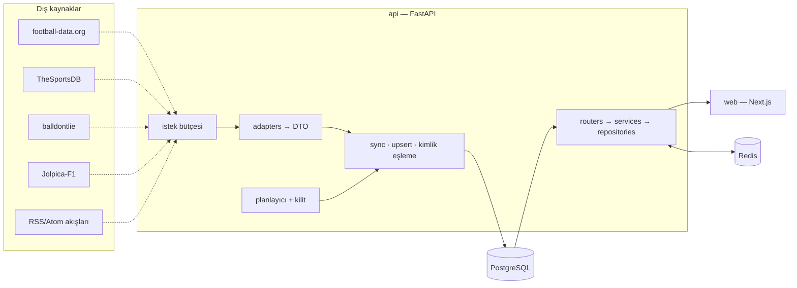

# Just Sport

Çok sporlu, modüler bir spor veri platformu.

- Bir Python servisi dış API'lerden ve yayıncıların RSS akışlarından veri çeker, ortak bir şemaya
  normalize edip PostgreSQL'e yazar.
- Next.js arayüzü yalnızca kendi API'mizi okur.
- Sitede görünen her bilgi gerçek bir kaynaktan gelir. Kaynağı yapılandırılmamış bir spor için
  "yapılandırılmadı" denir; örnek veri gösterilmez.

> Durum: **v0.4.0, gerçek veri.** Kapsam:
> - Futbol (football-data.org'un ücretsiz katmanındaki 12 lig; Süper Lig için TheSportsDB)
> - NBA (balldontlie)
> - Formula 1 (Jolpica)
> - Gerçek haber akışları (BBC Sport, ESPN, Yahoo Sports, Habertürk, Sporx)
>
> Sıradaki aşamalar: [docs/PROGRESS.md](docs/PROGRESS.md).

## Özellikler

**Veri**
- Bugünün karşılaşmaları, fikstür, sonuçlar, puan tablosu.
- Lig istatistikleri: gol krallığı, liderlik tabloları, sezon geçmişi.
- Takım analizi: form, iç saha/deplasman, geçmiş karşılaşmalar.
- Karşılaştırma ve grafikler.
- Spora özel şablonlar: futbol lig tablosu, NBA konferansları, F1 yarış kartı ve şampiyona.

**Haberler**
- Yalnızca başlık, yayıncının kısa özeti (en fazla 2 cümle), tarih, kaynak ve orijinal habere link.
- Kategoriler: resmî transfer, söylenti, röportaj, organizasyon, son dakika. 140 gerçek başlıkla
  değerlendirildi; doğruluk %96.
- Farklı yayıncılardan aynı haber tek kartta birleştirilir.

**Dürüst veri**
- Her sayfada "Kaynak · Son güncelleme" satırı.
- Sağlayıcı hata verirse son başarılı veri gösterilir ve "Veri gecikmeli" uyarısı çıkar.
- Ücretsiz katmanı gecikmeli olan canlı skorlarda "gecikmeli olabilir" notu.

**Kullanıcı**
- GitHub/Google ile giriş.
- Favori takım, sporcu ve lig; kişisel panel.
- Hesabı ve tüm veriyi silme.
- Gizlilik sayfası.

**Arayüz**
- TR/EN dil desteği.
- 6 renk paleti (yüksek kontrast dahil), koyu/açık tema.
- Mobil öncelikli ve erişilebilir.

**Operasyon**
- Sağlayıcı başına istek bütçesi; 429 gelirse `Retry-After`'a uyulur.
- Canlı, bugün ve boşta durumuna göre değişen yenileme sıklığı.
- Tek süreçte zamanlayıcı (PostgreSQL kilidi).
- `/health` ve `/admin/status`.

## Veri modu

| `DATA_MODE` | Davranış |
| --- | --- |
| `live` (varsayılan) | Yalnızca gerçek sağlayıcı verisi. Anahtarı olmayan sağlayıcı "yapılandırılmadı" olur. Fixture veya örnek haber asla okunmaz, yazılmaz, gösterilmez. |
| `demo` | Gömülü örnek veri (`demo:` kaynak önekiyle) ve her sayfada "Örnek veri" şeridi. Yalnızca yerel deneme içindir. |

Örnek veriyi bir veritabanından silmek için: `uv run python -m app.scripts.purge_demo`.

Hangi kaynağın yapılandırıldığını değerleri göstermeden görmek için:
- `uv run python -m app.scripts.check_sources`
- veya `GET /api/v1/admin/sources` (`X-Admin-Token` başlığıyla).

Sağlayıcılar, limitler, kullanım koşulları ve görsel politikası:
[docs/DATA-SOURCES.md](docs/DATA-SOURCES.md).

## Portföy modu (gerçek armalar, haber fotoğrafları, Süper Lig)

Kendi makinende tam görünüm için `api/.env`'e iki satır ekle:

```env
SHOW_PROVIDER_IMAGES=true   # kulüp/lig armaları, NBA logoları, haber fotoğrafları (kaynağından bağlanır)
ESPN_ENABLED=true           # Süper Lig: ESPN'in anahtarsız, resmî olmayan site API'si
```

İkisi de repo varsayılanında kapalıdır: görsellerin ve ESPN verisinin herkese açık yayında
kullanım hakkı ayrıca gerekir (`docs/DATA-SOURCES.md`). Görseller sunucuya indirilmez.

## Mimari



Ayrıntılar:
- [ARCHITECTURE](docs/ARCHITECTURE.md)
- [DECISIONS](docs/DECISIONS.md)
- [DATA-SOURCES](docs/DATA-SOURCES.md)
- [AUTH-SETUP](docs/AUTH-SETUP.md)
- [DEPLOY](docs/DEPLOY.md)

## Yerel geliştirme

Gereksinimler: Python 3.12 + [uv](https://docs.astral.sh/uv/), Node 22+.

```bash
# API: api/.env.example'ı api/.env olarak kopyalayın, anahtarlarınızı girin
cd api
uv sync
uv run alembic upgrade head
uv run python -m app.scripts.check_sources   # hangi kaynaklar etkin?
uv run uvicorn app.main:app --reload

# Web (başka bir terminal): web/.env.example → web/.env.local
cd web
npm install
npm run dev
```

**Anahtarsız deneme:**
- `DATA_MODE=demo` ve `uv run python -m app.scripts.seed` ile örnek veri yüklenir; her sayfada
  "Örnek veri" şeridi görünür.
- Docker ile: `docker compose up --build`. Compose varsayılan olarak demo modunda açılır;
  `DATA_MODE=live` ile gerçek veriye geçer.

## Test ve kalite

```bash
cd api && uv run pytest --cov=app && uv run ruff check . && uv run ruff format --check .
cd web && npm run lint && npx tsc --noEmit && npm test && npm run build
```

- Testler internetsiz koşar ve geliştiricinin `.env` dosyasını **okumaz**.
- Varsayılan veritabanı SQLite'tır. PostgreSQL için `TEST_DATABASE_URL`, Redis için
  `TEST_REDIS_URL` verin.
- CI (`.github/workflows/ci.yml`) testleri PostgreSQL + Redis ile çalıştırır.

## Teknoloji

**Backend:** Python 3.12, FastAPI, Pydantic v2, SQLAlchemy 2 (async) + asyncpg, Alembic, httpx,
tenacity, APScheduler, defusedxml, Redis, pytest, respx, ruff

**Frontend:** Next.js (App Router), TypeScript (strict), Tailwind CSS, Auth.js, Recharts,
lucide-react, next-themes, Vitest + Testing Library

**Barındırma:** Vercel (web), Render (api), Neon (PostgreSQL), Upstash (Redis). Bkz.
[DEPLOY](docs/DEPLOY.md).

## Lisans

[MIT](LICENSE). Veriler üçüncü taraf sağlayıcılara, haberler yayıncılarına aittir; atıflar
`/sources` sayfasındadır.
