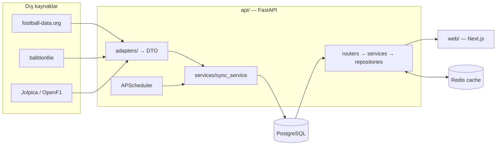

# Mimari

## Katmanlar
- **adapters/**: yalnızca dış veriyi çeker ve ortak DTO'lara çevirir. DB'ye yazmaz. `registry.py` adapter'ları adla bulur.
- **services/**: iş mantığı. `sync_service` DTO'ları `(source, external_id)` üzerinden upsert eder ve `sync_runs` kaydı tutar.
- **repositories/**: SQLAlchemy sorguları. **models/**: ORM şeması.
- **routers/**: `/api/v1` altında Pydantic response modelleri, tutarlı hata gövdesi `{"error": {"code","message"}}`.
- **web/**: Server Components + `fetch` revalidate; tüm istekler `lib/api.ts` üzerinden.

## Veri modeli
`sports → competitions → seasons → events → event_participants`, `teams`, `players`, `standings`, `sync_runs`. Genel `events` tablosu maç ve yarışı taşır; spora özel alanlar `extra` JSONB'dedir.
