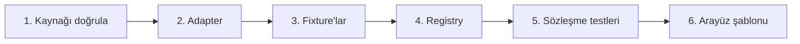

# Yeni bir spor eklemek

Just Sport'ta yeni bir spor eklemek şu işlerden ibarettir: **bir adapter sınıfı + fixture'lar + registry satırı + (isteğe bağlı) arayüz şablonu satırı.** Veritabanı şeması, API uçları, senkronizasyon ve testlerin çoğu değişmez. Basketbol (`balldontlie.py`) ve Formula 1 (`jolpica.py`) bu rehberin çalışan örnekleridir.



## 1. Veri kaynağını doğrula (tahmin etme)
Güncel dokümanı okuyup şunları not edin ve `docs/DECISIONS.md`'ye yazın:
- Base URL, kimlik doğrulama (başlık adı, `Bearer` var mı), anahtar gerekiyor mu
- **Ücretsiz katman limitleri** (istek/dk, istek/saat) ve hangi uçların ücretsiz olduğu
- Sayfalama biçimi (cursor mu, limit/offset mi, azami sayfa boyutu)
- Zaman damgası biçimi ve saat dilimi (hepsi UTC'ye çevrilecek)
- Zorunlu başlıklar (ör. Jolpica `User-Agent` ister)

Ücretsiz katmanda eksik bir uç varsa (balldontlie `/standings`) veriyi eldeki uçlardan **hesaplayın**, ya da eksiği loglayıp boş bırakın (oyuncu listesi gibi); adapter çökmemeli.

## 2. Adapter'ı yaz — `api/app/adapters/<kaynak>.py`
`HttpFixtureAdapter` (`adapters/http_fixture.py`) hız sınırı, `tenacity` ile yeniden deneme, zaman aşımı ve fixture modunu hazır getirir. Siz yalnızca kaynağa özgü kısmı yazarsınız:

```python
class MySportAdapter(HttpFixtureAdapter):
    sport_slug = "tennis"          # URL ve DB'de kullanılan slug
    sport_name = "Tenis"           # arayüzde görünen ad
    source = "my-source"           # registry anahtarı ile AYNI olmalı
    default_competitions = ("atp",)  # senkronizasyonun varsayılan hedefleri
    fixtures_subdir = "my_source"
    base_url = "https://api.example.com/v1"
    requires_api_key = True        # anahtarsız kaynakta False

    def __init__(self, settings, client=None):
        super().__init__(
            settings,
            api_key=settings.my_source_api_key,
            headers={"Authorization": settings.my_source_api_key},
            min_interval=12.5,     # ücretsiz katman limitinden türetin
            client=client,
        )

    def shift_fixture_dates(self, data, delta): ...   # fixture tarihlerini kaydır

    async def fetch_competitions(self) -> list[CompetitionDTO]: ...
    async def fetch_teams(self, competition_ext_id, season) -> list[TeamDTO]: ...
    async def fetch_events(self, competition_ext_id, season) -> list[EventDTO]: ...
    async def fetch_standings(self, competition_ext_id, season) -> list[StandingDTO]: ...
```

Kurallar:
- Adapter **yalnızca çeker ve DTO'ya çevirir**; veritabanına yazmaz (yazma işi `sync_service`'tedir).
- Dış ham verinin normalizasyonunu saf fonksiyonlara ayırın (`normalize_game(raw) -> EventDTO`); test etmesi kolaydır.
- `EventDTO.kind`: maç için `match`, yarış için `race`, ek seanslar için `session`. `status`: `scheduled | live | finished | postponed | cancelled`.
- `start_time` **UTC ve timezone'lu** olmalı (naive datetime veritabanı katmanında reddedilir).
- Spora özel her şey `extra` sözlüklerine gider (`EventDTO.extra`, `ParticipantDTO.extra`, `StandingDTO.extra`, `PlayerDTO.extra`); ortak alanları kirletmeyin.
- Kişisel sıralamalar (F1 sürücüsü): `ParticipantDTO.player_external_id` / `StandingDTO.player_external_id`. Takım sıralamaları: `team`. Aynı sezon için iki şampiyona dönecekse `extra["kind"]` ile ayırın.
- Çok sayfalı uçlarda sayfa sınırının bir kaydı ikiye bölebileceğini unutmayın (Jolpica sonuçları: `round`'a göre birleştirilir).
- Yeni ortam değişkeni → `Settings` (`app/core/config.py`) ve `api/.env.example` (açıklamasıyla).

## 3. Fixture'lar — `api/fixtures/<kaynak>/`
Fixture'lar **ham API biçiminde** olmalı; böylece normalizasyon fixture modunda da gerçek yolla çalışır. `api/tools/generate_*_fixtures.py` örneklerine bakın:
- Gerçek takım/sürücü adları, **sentetik sonuçlar**; deterministik (`random.Random(seed)`).
- Dosyanın en üstüne `"_fixture": {"reference_date": "YYYY-MM-DD"}` koyun. Fixture modunda adapter bu tarih ile "bugün" arasındaki gün farkını **tüm tarihlere** ekler (`shift_fixture_dates`), böylece "bugünün karşılaşmaları" hep doludur. Kaydırma yalnızca `USE_FIXTURES=true` iken çalışır; gerçek API yanıtlarına asla dokunulmaz (her adapter için test var).
- Bitmiş, yaklaşan ve (mümkünse) canlı etkinlik bulundurun; sözleşme testleri bitmiş ve yaklaşan etkinlik arar.

## 4. Registry — `api/app/adapters/registry.py`
```python
ADAPTERS = {
    "football-data": FootballDataAdapter,
    "my-source": MySportAdapter,   # <- tek satır
}
```
Sporun `sports` satırı ilk senkronizasyonda otomatik oluşur (`ensure_sport`); `football`, `basketball`, `formula-1` ayrıca migration ile tohumlanır.

## 5. Sözleşme testleri
`tests/test_adapter_contract.py` registry'deki **her** adapter için otomatik koşar: kimlik, benzersiz id'ler, UTC zamanlar, durum değerleri, fixture tarih kaydırması, gerçek veritabanına senkronizasyonun idempotentliği ve "anahtar yoksa fixture'a düş + zamanlayıcı atlar" davranışı. Yeni adapter'ınız bunlardan geçmiyorsa ortak sözleşmeyi bozuyordur.

Ek olarak kaynağa özgü bir `tests/test_<kaynak>_adapter.py` yazın: durum eşlemesi, `respx` ile gerçek mod (kimlik başlığı, sayfalama, 429'da yeniden deneme), gerçek modda tarihlerin kaymadığı.

```bash
cd api
uv run python tools/generate_<kaynak>_fixtures.py
uv run pytest -q
uv run python -m app.scripts.seed   # DATABASE_URL ile yerelde dene
```

## 6. Arayüz şablonu — `web/lib/sports.ts`
API tüm sporlarda aynı şekli döndürür; **nasıl gösterileceği** `TEMPLATES` tablosundadır:

```ts
tennis: {
  icon: Trophy,                 // spor seçicide görünen ikon
  standings: "league",          // "league" | "conference" | "championship"
  tabs: { fixtures: "Maçlar", results: "Sonuçlar", standings: "Sıralama" },
  pageSize: 20,                 // uzun kartlar (yarış) için küçük tutun
},
```

- Yeni bir sıralama düzeni gerekiyorsa `components/sport/` altına bileşen ekleyip `StandingsLayout` ve `app/[sport]/[competition]/page.tsx` içindeki `switch`'e bağlayın (örnekler: `conference-standings.tsx`, `championship-tables.tsx`).
- Etkinlik kartı `EventItem` ile `event.kind`'a göre seçilir (`match` → `EventRow`, `race` → `RaceRow`). Yeni bir etkinlik türü için buraya bir dal ekleyin.
- Oyuncu pozisyon grupları: `lib/events.ts` → `positionGroup`. Oyuncu profilindeki spora özel bilgiler: `app/players/[id]/page.tsx` → `SPORT_FACTS`.
- Tüm metinler `lib/i18n/tr.ts` içinde olmalı.
- `lib/sports.ts`, `lib/events.ts` ve yeni bileşenler için Vitest testi ekleyin (`components/sport/sport-templates.test.tsx` örnek).

## Kontrol listesi
- [ ] Kaynak doğrulandı, limitler ve kararlar `DECISIONS.md`'de
- [ ] Adapter + normalizasyon fonksiyonları, rate limit ve `User-Agent`/kimlik başlıkları
- [ ] Fixture'lar ham biçimde, `_fixture.reference_date` var, üreteç betiği commit'lendi
- [ ] Registry satırı; `.env.example` güncel
- [ ] Sözleşme testleri yeşil + kaynağa özgü testler
- [ ] `web/lib/sports.ts` satırı, gerekirse bileşen ve testler
- [ ] `ruff`, `pytest`, `eslint`, `tsc`, `vitest`, `next build` yeşil
